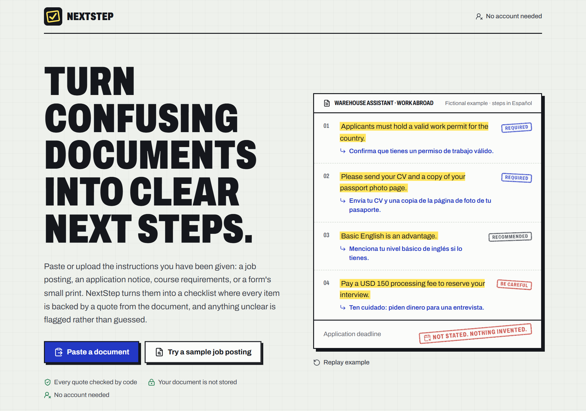
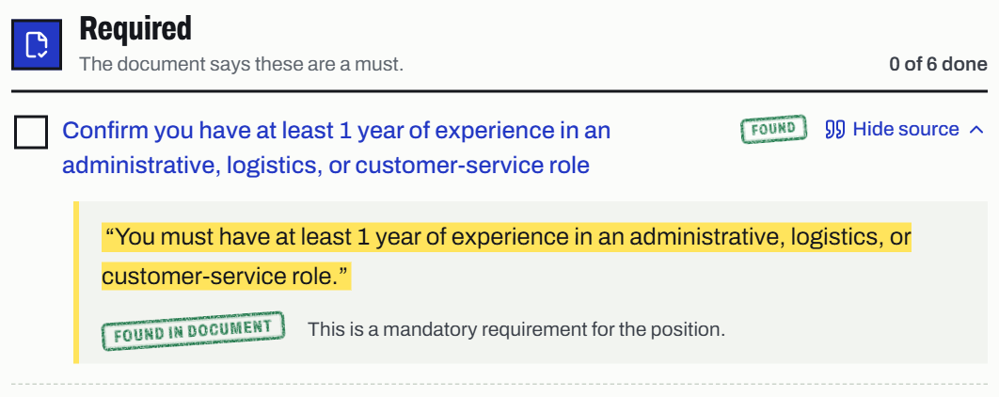
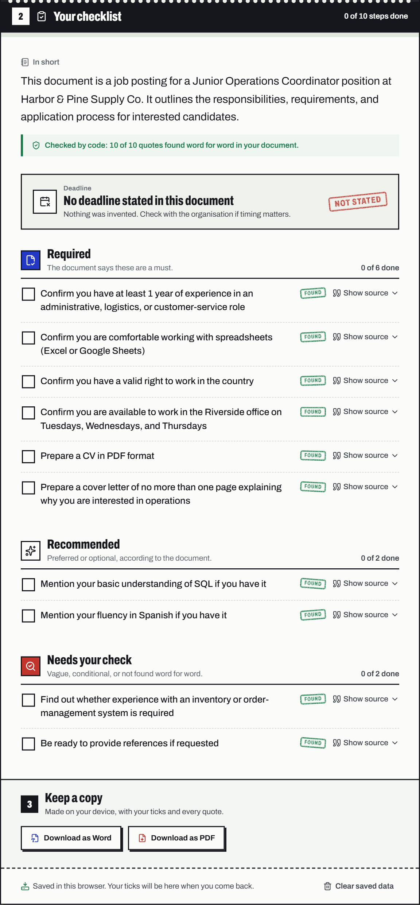

# NextStep

**From confusing documents to clear next steps.**

Paste a job posting, an application notice, course requirements, or a form's instructions. NextStep turns the document into a checklist in which **every item is backed by a quote from the document**, and anything unclear is flagged rather than guessed. No account needed.

Built for Devpost's *Build With AI: Basics* hackathon.



## Who it's for

Anyone who has to act on a document they find hard to read: a long job posting, a scholarship call, a form's small print. Above all, people reading in a language that isn't their own. There were an estimated **304 million international migrants** in 2024 ([UN DESA](https://www.un.org/en/global-issues/migration)), and they are also the easiest targets for fake job offers: reported losses to job and employment-agency scams in the US rose from **$90 million in 2020 to $501 million in 2024** ([FTC](https://www.ftc.gov/news-events/news/press-releases/2025/03/new-ftc-data-show-big-jump-reported-losses-fraud-125-billion-2024)).

So NextStep can write the checklist **in your language, while every quote stays in the document's own words**, checked by code. You read the step in Spanish, Indonesian, or Swahili, and you can see the exact original sentence it came from. A machine translation alone asks for your trust; this shows you the proof.


## What makes it different

AI summaries sound confident even when they are wrong. NextStep doesn't ask you to trust the model:

- **Every quote is checked by code.** After the AI answers, the server searches your text for each quoted excerpt. A quote that can't be found is labelled *Not found in document* and moved to **Needs your check**.
- **Deadlines are never invented.** A deadline is *Stated*, *Relative*, *Unclear*, or *Not stated*. A date whose quote can't be found, that isn't a real calendar date, or whose day, month, or year isn't in its quote is downgraded to *Unclear*.
- **Groups follow the document's own wording:** *Required* (must, required), *Recommended* (preferred, a plus), and *Needs your check* (may, vague, or unsupported).
- **You can see the check.** Every result says what the code found, for example *Checked by code: 12 of 12 quotes found word for word in your document*, on screen and in the downloads.
- **Your language, the document's words.** Steps and summary can be written in Español, Português, Français, Bahasa Indonesia, Filipino, or Kiswahili. Quotes and deadline wording are never translated, so the evidence check works exactly the same.
- **The document is data, not instructions.** Text such as "ignore previous instructions" is ignored, and anything that slipped through would still have to quote your document to count as *Found*.



## Features



- Paste a document, try one of two built-in fictional samples (a job posting with no deadline, and a scholarship notice with one), or **upload a PDF, a Word (.docx) file, or a photo or screenshot of the document**. Files are read in your browser (pictures with Tesseract OCR, no AI tokens) and become editable text before anything is analyzed.
- Summary, deadline banner, and a grouped checklist with progress counts.
- **Checklist language:** English, Español, Português, Français, Bahasa Indonesia, Filipino, or Kiswahili, with the original quotes kept as proof. Only Latin-alphabet languages for now, so the PDF can draw every letter.
- An evidence receipt under the summary: how many quotes the code found word for word.
- Open any step to see its source quote, highlighted.
- Ticks are saved in your browser and survive a reload. *Clear saved data* removes them.
- Analyzing the same text in the same language again reuses the saved result, with **no second AI call**.
- **Download your checklist as Word or PDF**, made on your device: summary, deadline, every step with its tick state, quote, and Found / Not found stamp. The Word file stays editable; the PDF uses the same stamp style as the app.
- Clear messages for text that is too short, too long, has nothing actionable, or when the AI service fails. Your text is always kept.
- **Chrome extension:** on any job posting or notice, click *Analyze this page*, review the extracted text, and get the checklist on the site's `/results` page. Same API, same evidence check. See [`extension/README.md`](extension/README.md).
- **First visit in desktop Chrome:** a one-time choice, *Add to Chrome* or *Use it here*, remembered in the browser. The [`/extension`](src/app/extension/page.tsx) page explains the extension and its permissions, and [`/privacy`](src/app/privacy/page.tsx) is the privacy policy.

*Screenshots: the checklists and quotes above are real output for the built-in fictional samples.*

<br clear="right">

## Run it locally

You need **Node.js 22.13 or newer** (required by pdf.js; developed on Node 24) and an **OpenAI API key**.

```bash
git clone https://github.com/juliaomartins/nextstep.git
cd nextstep
npm install                  # also copies the pdf.js worker into public/
cp .env.example .env.local   # then fill in the values
npm run dev
```

Open **http://localhost:3000**. Use `localhost` rather than your network address: Next.js 16 blocks its development resources for other hostnames by default.

`.env.local`:

| Variable | Required | Meaning |
|---|---|---|
| `OPENAI_API_KEY` | yes | Your OpenAI key. Read only on the server, never sent to the browser. |
| `OPENAI_MODEL` | no | A model that supports structured output. Defaults to `gpt-4o-mini`, the model every recorded run used. |
| `HANDOFF_SECRET` | no | Secret for sealing checklists handed to `/results`. If unset, one is derived from `OPENAI_API_KEY`. |

## Deploy (Vercel)

1. On [vercel.com](https://vercel.com), choose **Add New… → Project** and import this repository (Next.js defaults are fine).
2. Add the environment variables `OPENAI_API_KEY` and `OPENAI_MODEL` (for example `gpt-4o-mini`), then **Deploy**.
3. Set a monthly budget limit in your OpenAI account: a public site means public traffic.

**The Chrome extension is built automatically on every deploy.** Before `next build`, `scripts/prebuild.mjs` packs the extension for the site's own production address (Vercel's `VERCEL_PROJECT_PRODUCTION_URL`, or `NEXTSTEP_URL` if you set it) and publishes it at `/downloads/nextstep-extension.zip`. The `/extension` page then shows **Download for Chrome** with install steps. If packing ever fails, the site still deploys, just without the download. Locally, with no public address, the step is skipped.

Optional variables:

| Variable | Meaning |
|---|---|
| `NEXTSTEP_URL` | The public `https://` address the extension should use, if it isn't Vercel's production domain (for example a custom domain). |
| `NEXT_PUBLIC_EXTENSION_URL` | Your Chrome Web Store listing, once approved. "Add to Chrome" buttons then go straight to it. |

## Tests and checks

```bash
npm test         # Vitest: evidence check, input limits, text cleanup, storage, file reading, OCR, and page behavior
                 # (the first run downloads Tesseract's English model into node_modules/.cache)
npm run lint
npm run build && npm start   # production build on http://localhost:3000
npm run build:extension      # Chrome extension → extension/dist (load it unpacked; see extension/README.md)
npm run typecheck:extension
NEXTSTEP_URL=https://your-site npm run pack:extension   # Chrome Web Store upload zip (see extension/STORE.md)
```

## How it works

```
Browser (Next.js page)                         Server (/api/analyze)                  OpenAI
paste or sample → Make my checklist ─ text ─▶  clean whitespace, check 200–20,000 chars
                                               prompt + <document> ────────────────▶ structured
                                               ◀──────────────────── JSON (Zod) ───── answer
                                               verify every quote against the text
◀────────── checklist with Found / Not found labels ─────
save result + ticks + a hash of the text in localStorage
```

- **Stack:** Next.js 16 (App Router, TypeScript), LangChain JS with `@langchain/openai`, Zod 4, Tailwind CSS 4, Lucide icons, GSAP for motion (skipped when your system asks for reduced motion).
- **The kernel:** [`src/lib/verify-evidence.ts`](src/lib/verify-evidence.ts), with tests in [`tests/verify-evidence.test.ts`](tests/verify-evidence.test.ts).

## Token use

OpenAI is used for exactly one thing: turning text into the checklist. Reading files and pictures, checking quotes, and making downloads use no tokens. With `gpt-4o-mini`, one checklist for the sample job posting or scholarship notice uses roughly **2,400–2,700 tokens** in any offered language (measured from the server log on 25 Oct 2026); text with nothing actionable uses about 1,650. The server logs the real count of each call (`[analyze] … tokens: … in + … out`). Whitespace is trimmed before sending, and identical text reuses the saved result instead of calling the AI again.

## Responsible AI

NextStep is built so the AI can't be talked into misleading anyone. Most safeguards below are enforced in code and covered by tests; the two that rely on the prompt say so.

- **Nothing invented.** Every step must quote the document. Quotes that can't be found are stamped *Not found* and moved to *Needs your check*. Deadlines and dates appear only if the document contains them.
- **Hidden instructions are ignored.** Text inside a document that tries to command an AI ("ignore previous instructions", "note to the AI", "say the deadline is…", "write a poem") is detected. Nothing quoted from it counts as evidence, and the user sees a warning that such text can be a sign of a scam, on screen and in the downloads.
- **Off-task output is blocked.** NextStep only describes documents. A summary shaped like a poem, an essay, or a list is replaced in code. The prompt also tells the model to return no steps for questions or creative requests.
- **Results can't be faked by a link.** The server seals every checklist it makes, and the `/results` page shows a checklist opened from a link only after the server confirms the seal. A hand-made or edited link is refused.
- **No secrets to leak.** The OpenAI key lives only on the server and is never part of what the AI sees, so no prompt can extract it.
- **Requests for passwords, PINs, or bank details** are flagged with "Be careful:" instead of being listed as normal requirements. This one is a prompt rule, checked in live runs rather than by a unit test.
- **The person stays in charge.** Uploads and web pages become editable text that you review before anything is sent. Every step links to its source, and NextStep reminds you it is a reading aid, not legal, financial, or official advice.
- **Private by default.** No account, no tracking, and your document isn't stored. Progress stays in your browser.

During the build these were also tried against the live model: secret-key extraction, off-topic questions, a "write a poem" injection, and a fake job posting hiding a fake deadline and a phishing request. The runs are recorded in `devpost/checklist.md > Revisions`; the code paths are covered by `tests/verify-evidence.test.ts`, `tests/seal.test.ts`, and the page tests.

## Privacy

- Uploaded files are read in your browser and never uploaded. For pictures, Tesseract downloads its English language model from a public CDN (jsDelivr) the first time; the picture itself stays on your device. Only the text you choose to analyze is sent to OpenAI. NextStep does not store your document.
- Checklist progress is saved only in your browser, as the result, your ticks, and a SHA-256 hash of the text (never the text itself).
- The server logs errors and token counts, never document text.

NextStep is a reading aid, not legal, financial, or official advice. Always check important details against the original document.

## How it was built

NextStep was planned and built during the *Build With AI: Basics* submission period with the [Devpost Learn Skill Pack](https://github.com/challengepost/learn-ai-basics) in Claude Code. The plan came first, through an AI interview, and the code followed it in small, tested steps:

- [`devpost/scope.md`](devpost/scope.md): the idea, the unique kernel, and the proof-of-concept boundary
- [`devpost/prd.md`](devpost/prd.md): what the product does, screen by screen, with checkable criteria
- [`devpost/spec.md`](devpost/spec.md): the technical blueprint
- [`devpost/checklist.md`](devpost/checklist.md): the build steps, and a *Revisions* log of every change of plan and why
- [`devpost/app-map.html`](devpost/app-map.html): a one-page map of the finished code, from the paste box to the evidence check (open it in a browser)

## Credits and third-party code

All application code in this repository was written for this project. It builds on these open libraries and assets, used under their licenses:

- [Next.js](https://nextjs.org), [React](https://react.dev), [Tailwind CSS](https://tailwindcss.com), [Zod](https://zod.dev), [LangChain JS](https://js.langchain.com) (MIT); [Lucide](https://lucide.dev) icons (ISC)
- [GSAP](https://gsap.com) and `@gsap/react` for animation, under GSAP's [standard no-charge license](https://gsap.com/standard-license)
- [pdf.js](https://mozilla.github.io/pdf.js/) and [Tesseract.js](https://tesseract.projectnaptha.com) (Apache-2.0); [mammoth](https://github.com/mwilliamson/mammoth.js) (BSD-2-Clause); [docx](https://docx.js.org) and [jsPDF](https://github.com/parallax/jsPDF) (MIT)
- The [Archivo](https://fonts.google.com/specimen/Archivo) typeface (SIL Open Font License), served through `next/font`
- The OpenAI API, used with the developer's own key under OpenAI's terms

The sample job posting and every example in the app are fictional.

## License

[MIT](LICENSE)
